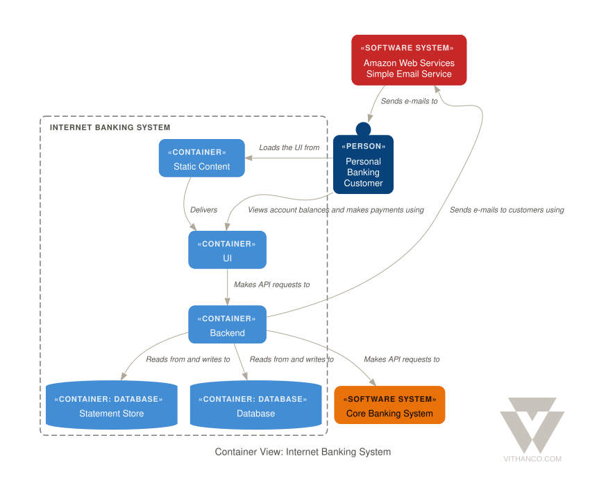

# VGraph

**Vithanco** stands for **Vi**sual **Th**inking **an**d **Co**mmunication. It
helps you think in a structured way by drawing **typed network graphs**. In a
typed graph every node and every edge has a meaning of its own: in an IBIS map a
Question, an Answer, a Pro and a Con are different things, and the notation says
how they may be connected. The drawing becomes a way of reasoning, and a way of
explaining that reasoning to someone else.

VGraph is the open-source engine behind it. It lays a typed graph out and draws
it as SVG. The **Vithanco Graph Language (VGL)** is only the *how*: a small text
format in which these diagrams are written down, stored and shared. The same
Swift code runs natively and, compiled to WebAssembly, in the browser, in
Obsidian, in VS Code and behind an MCP server, so a diagram looks the same
everywhere.

```
vgraph decision: IBIS "Should we ship the plugin?" {
  node q1: Question "Should we ship?";
  node a1: Answer "Yes, soon";
  node p1: Pro "Users have asked for it";
  node c1: Con "Docs are still thin";
  edge q1 -> a1;
  edge a1 -> p1;
  edge a1 -> c1;
}
```

A **notation** is the vocabulary of a diagram: it fixes the node and edge types
and how they look. Every document names one. These ship with VGraph: IBIS, BBS,
Impact Mapping, Concept Map, Current Reality Tree, Evaporating Cloud, Future
Reality Tree, Prerequisite Tree, Transition Tree, Attack-Defense Tree, Goal
Tree, Causal Loop Diagram, Decision Tree, Timeline, C4 and Arithmetic. A
document can also declare notations of its own. The
[VGL guide](docs/VGL_GUIDE.md) has the whole language.



## Ways to use it

| | |
|---|---|
| **Web editor** | [vithanco.com/editor](https://vithanco.com/editor/): write VGL, see the diagram, edit it on the canvas |
| **Obsidian** | [obsidian-vithanco](https://github.com/Vithanco/obsidian-vithanco): a `vgl` code block becomes a diagram |
| **VS Code** | [vscode-vithanco](https://github.com/Vithanco/vscode-vithanco) |
| **MCP server** | `npx @vithanco/vgraph-mcp` runs it locally; `https://mcp.vithanco.com/mcp` is hosted. [Details](vgraph-mcp-node/README.md) |
| **Command line** | `vgraph-cli`, built from this repository |
| **Swift package** | the `VGraph`, `VGLanguage` and `VGraphSVG` libraries |

## Building

Two tiers, so a parser fix does not send you through a toolchain install:

- **Native only.** `swift build` and `swift test` need nothing but a Swift 6.4
  toolchain.
- **With the wasm build.** `just build`, `just test`, the wasm smoke tests and
  the editor's browser tests also need Node, `jq`, `binaryen`, `wabt`,
  [`just`](https://github.com/casey/just) and the Embedded Swift SDK that
  matches `.swift-version`.

Install the toolchain with [swiftly](https://github.com/swiftlang/swiftly), then
the SDK. One bundle holds both the plain and the `-embedded` SDK, and its version
must equal `.swift-version`. The checksum is per release; take it from
swift.org's [WebAssembly guide](https://swift.org/documentation/articles/wasm-getting-started.html).

```bash
V=$(cat .swift-version)
swiftly install "$V" && swiftly use "$V"
swift sdk install "https://download.swift.org/swift-$V-release/wasm-sdk/swift-$V-RELEASE/swift-$V-RELEASE_wasm.artifactbundle.tar.gz" \
    --checksum <checksum for $V from the guide>
```

`just doctor` lists what is missing; a missing SDK is reported but does not fail
it.

```bash
just build     # compile everything: wasm, command line, MCP server
just test      # build, then the full suite: Swift, wasm smoke tests, editor browser tests
just           # everything else
```

For most changes `swift test` is the quick loop. The Obsidian and VS Code
plugins are separate repositories; `just plugins-setup` clones them next to this
one, and the build and test recipes use them when they are there.

## How it is organised

VGraph is built as hexagons: a pure domain at the centre, ports that name each
conversation with the outside, and adapters at the edge. The parser, the SVG
renderer and the Graphviz layout are separate targets that know only the core.
[Why it is shaped this way](docs/hexagonal-architecture.md) and
[where a change goes](docs/where-things-live.md) are written down, as are the
decisions behind the design ([ADRs](docs/adr/)) and the visual rules
([design guide](docs/design/README.md)).

## Contributing

Pull requests are welcome, and so are issues. Start with
[CONTRIBUTING.md](CONTRIBUTING.md).

## Licence

Apache-2.0, see [LICENSE](LICENSE). Third-party works, among them Graphviz and
the DM Sans typeface, are listed in [NOTICE](NOTICE). The Vithanco name and
logo are not covered by the licence: the artwork is all rights reserved, and a
fork should use a name and a logo of its own. See
[graphics/README.md](graphics/README.md) for what is allowed.
